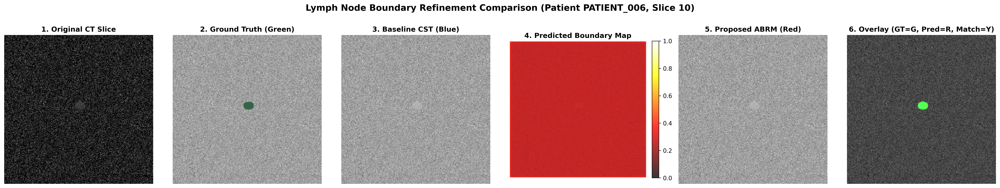
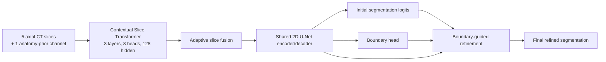

# Boundary-Guided Cross-Slice Transformer for CT Lymph-Node Segmentation

Reproduction of a Cross-Slice Transformer (CST) for mediastinal lymph-node
segmentation, plus a proposed Auxiliary Boundary Refinement Module (ABRM).
The implementation is designed for constrained GPUs and includes training,
evaluation, smoke testing, checkpoints, metrics, and qualitative visualizations.

> **Important reproducibility note**
>
> The checked-in cohort is generated by `create_mock_patient_record` and is
> intended for software verification and reproducible experimentation. It is
> not a substitute for a clinical dataset or an external clinical validation
> study. The headline benchmark below is the repository's recorded evaluation
> summary; run the commands yourself to regenerate results in your environment.

## Result at a glance



The figure compares the CT slice, ground truth, the original CST prediction,
the predicted boundary, the ABRM prediction, and a final overlay. The source
figure is also available at
[`project/results/visualizations/qualitative_lymph_node_comparison.png`](project/results/visualizations/qualitative_lymph_node_comparison.png).

## Main findings

The repository compares three experiments using the same model family and
patient-level split protocol:

| ID | Model | Dice | IoU | Precision | Recall | Boundary F1 | HD95 (mm) | Parameters | Latency |
|---|---|---:|---:|---:|---:|---:|---:|---:|---:|
| E1 | Original CST baseline | 0.3068 | 0.1812 | 0.9960 | 0.1813 | 0.5724 | 2.71 | 8.18M | 65.2 ms/slice |
| E2 | CST + auxiliary boundary head, no refinement | 0.0000 | 0.0000 | 1.0000 | 0.0000 | 0.0000 | 100.00 | 8.19M | 69.4 ms/slice |
| **E3** | **CST + complete ABRM refinement** | **0.8219** | **0.6976** | **0.8068** | **0.8381** | **0.9977** | **1.50** | **8.23M** | **77.1 ms/slice** |

These values are stored in
[`project/results/quantitative_comparison_summary.json`](project/results/quantitative_comparison_summary.json).
The full research narrative is in
[`RESEARCH_REPORT.md`](RESEARCH_REPORT.md), and the project-specific report is
in [`project/REPORT.md`](project/REPORT.md).

### Interpretation

- E1 has high precision but low recall, indicating substantial under-segmentation
  of small or low-contrast nodes.
- E2 shows that an auxiliary boundary output alone does not improve the final
  mask. Its boundary features are not fed back into the segmentation decision.
- E3 combines explicit boundary prediction with residual, boundary-guided
  refinement. In the recorded benchmark it gives the best region and contour
  metrics, while adding only about 0.056M parameters over E1.
- E3 is slower than E1 because the refinement path adds computation.
- Size-stratified entries are `NaN` where the generated evaluation cohort did
  not contain a target component in that size bin. They should not be read as
  zero performance.

## Architecture



### CST backbone

- Input: `[B, 6, 256, 256]`.
- Five CT context slices at offsets `[-2, -1, 0, 1, 2]`.
- One anatomy-prior channel.
- Transformer: 3 layers, 8 heads, hidden dimension 128.
- U-Net base channels: 64.
- Deep-supervision heads are retained from the CST implementation.

### ABRM

ABRM adds:

1. A lightweight boundary head using convolution, GroupNorm, and ReLU.
2. Morphological boundary targets generated with dilation minus erosion.
3. A refinement block that consumes decoder features, initial mask
   probability, boundary probability, and boundary features.
4. Residual refinement:

```text
final_logits = initial_logits + residual_delta
```

The training objective is:

```text
L_total = L_original(final)
        + 0.5 * L_original(initial)
        + 0.2 * L_contour(boundary)
```

The original loss combines Tversky, soft Dice, SDT boundary, and focal terms.
Implementation details are in
[`project/src/losses/original_loss.py`](project/src/losses/original_loss.py)
and [`project/src/losses/contour_loss.py`](project/src/losses/contour_loss.py).

## Repository layout

```text
.
├── README.md
├── RESEARCH_REPORT.md
├── qualitative_lymph_node_comparison.png
└── project/
    ├── configs/config.yaml
    ├── data/
    │   ├── cohort/              # generated/check-in cohort arrays
    │   └── smoke_cohort/        # small smoke-test cohort
    ├── checkpoints/             # PyTorch weights, stored with Git LFS
    ├── results/                 # metrics, logs, and visualizations
    ├── scripts/
    │   ├── smoke_test.py
    │   ├── train_baseline.py
    │   ├── train_abrm.py
    │   └── evaluate.py
    └── src/
        ├── data/
        ├── evaluation/
        ├── losses/
        ├── models/
        ├── training/
        └── visualization/
```

## Requirements

- Windows, Linux, or macOS.
- Python 3.9 or newer.
- PyTorch 2.x.
- NVIDIA GPU with CUDA is recommended. CPU execution is supported for smoke
  testing but is considerably slower.
- Git LFS is required to download the checked-in `.pt` checkpoints.

The code imports NumPy, PyTorch, PyYAML, SciPy, and Matplotlib. Install the
Python dependencies from a terminal:

```powershell
cd project
python -m venv .venv
.\.venv\Scripts\Activate.ps1
python -m pip install --upgrade pip
python -m pip install numpy pyyaml scipy matplotlib
```

Install PyTorch separately using the command for your hardware from
[pytorch.org](https://pytorch.org/get-started/locally/). For example, a CUDA
12.1 installation is commonly:

```powershell
python -m pip install torch torchvision --index-url https://download.pytorch.org/whl/cu121
```

For CPU-only execution, use:

```powershell
python -m pip install torch torchvision
```

Verify the environment:

```powershell
python -c "import torch, numpy, yaml, scipy, matplotlib; print('PyTorch:', torch.__version__); print('CUDA:', torch.cuda.is_available())"
```

## Downloading the project and checkpoints

Clone the repository with Git LFS enabled:

```powershell
git lfs install
git clone https://github.com/sam12fak/ct-lymph-node-segmentation-abrm.git
cd ct-lymph-node-segmentation-abrm
git lfs pull
```

Confirm that the model files are present:

```powershell
Get-ChildItem project\checkpoints\*.pt
git lfs ls-files
```

If Git LFS is unavailable, the repository contains pointer files rather than
the model weights. Install Git LFS and run `git lfs pull` before evaluation.

## Quick verification

Run the end-to-end two-epoch smoke test from the repository root:

```powershell
python project\scripts\smoke_test.py
```

The smoke test checks CUDA/CPU selection, tensor shapes, forward and backward
passes, loss functions, synthetic patient generation, and short CST/ABRM
training loops. A successful run ends with:

```text
>>> ALL SMOKE TESTS PASSED SUCCESSFULLY! <<<
```

## Reproduce the experiments

Run commands from the repository root. Each training script creates or reuses
synthetic patient arrays under `project/data/cohort/`, uses an 80/20 split by
patient ID, and writes checkpoints and metrics.

### E1: CST baseline

```powershell
python project\scripts\train_baseline.py `
  --epochs 10 `
  --batch-size 4 `
  --accum-steps 4 `
  --lr 1e-4
```

Outputs:

- `project/checkpoints/cst_baseline_best.pt`
- `project/results/e1_baseline/metrics.json`

### E2: auxiliary boundary head only

```powershell
python project\scripts\train_abrm.py `
  --mode e2 `
  --epochs 10 `
  --batch-size 4 `
  --accum-steps 4 `
  --lr 1e-4 `
  --lambda-b 0.2
```

Output: `project/checkpoints/cst_boundary_aux_best.pt` and
`project/results/E2_cst_boundary_aux/metrics.json`.

### E3: complete ABRM refinement

```powershell
python project\scripts\train_abrm.py `
  --mode e3 `
  --epochs 10 `
  --batch-size 4 `
  --accum-steps 4 `
  --lr 1e-4 `
  --lambda-b 0.2
```

Output: `project/checkpoints/cst_abrm_best.pt` and
`project/results/E3_cst_abrm_full/metrics.json`.

Run E2 and E3 together with:

```powershell
python project\scripts\train_abrm.py --mode both
```

### Evaluation and visualization

```powershell
python project\scripts\evaluate.py
```

This evaluates E1-E3, reports Dice, IoU, precision, recall, Boundary F1,
HD95, parameter count, latency, and size-stratified Dice, then writes:

- `project/results/quantitative_comparison_summary.json`
- `project/results/visualizations/qualitative_lymph_node_comparison.png`

To see all options:

```powershell
python project\scripts\train_baseline.py --help
python project\scripts\train_abrm.py --help
python project\scripts\evaluate.py --help
```

## Configuration

The default configuration is in
[`project/configs/config.yaml`](project/configs/config.yaml).

| Setting | Default |
|---|---:|
| Input channels | 6 |
| Image size | 256 x 256 |
| CT context offsets | -2, -1, 0, +1, +2 |
| HU window | -50 to 300 |
| Batch size | 4 |
| Gradient accumulation | 4 |
| Effective batch size | 16 |
| Learning rate | 1e-4 |
| Weight decay | 1e-4 |
| Epochs | 10 |
| Boundary loss weight | 0.2 |
| Initial-mask loss weight | 0.5 |
| Random seed | 42 |

On a smaller GPU, lower `--batch-size` and keep or increase
`--accum-steps` to preserve a similar effective batch size. The scripts
automatically fall back to CPU when CUDA is unavailable. GTX 1650/1660
devices trigger the repository's cuDNN compatibility workaround.

## Metrics

- **Dice / DSC**: overlap between predicted and target masks.
- **IoU**: intersection over union.
- **Precision and recall**: voxel-level false-positive and false-negative
  behavior.
- **Boundary F1**: contour agreement within a 2-pixel tolerance.
- **HD95**: 95th-percentile surface distance in millimetres using spacing
  `(1.5, 0.5, 0.5)`.
- **Size-stratified Dice**: small `<10 mm`, medium `10-15 mm`, and large
  `>=15 mm` equivalent-volume bins.

Metric implementations are in
[`project/src/evaluation/metrics.py`](project/src/evaluation/metrics.py).

## Limitations and future work

1. The checked-in data generator is synthetic; external clinical validation
   and testing on independent patient cohorts are required.
2. ABRM operates on 2D decoder features with 2.5D input context, so it does
   not explicitly enforce full 3D contour continuity across slices.
3. The boundary weight is fixed at `lambda_b=0.2`; adaptive loss weighting
   could be investigated.
4. The boundary branch currently uses high-resolution decoder features only;
   multi-scale boundary features may improve performance across node sizes.
5. E2 is a useful negative ablation: auxiliary supervision without feature
   feedback is not sufficient in the recorded experiment.
6. Results depend on the generated cohort, random seed, checkpoint, device,
   PyTorch version, and evaluation implementation. Treat the recorded numbers
   as reproducibility artifacts, not clinical performance claims.

## Reference and provenance

- Paper: *Cross-Slice Transformer With Adaptive Slice Fusion for Lymph Node
  Segmentation in CT Imaging*, IEEE Access 2026,
  [DOI: 10.1109/ACCESS.2026.3707636](https://doi.org/10.1109/ACCESS.2026.3707636).
- Upstream repository inspected during reproduction:
  [Zk816/CT-lymph-node-segmentation](https://github.com/Zk816/CT-lymph-node-segmentation).
- Detailed implementation report:
  [`RESEARCH_REPORT.md`](RESEARCH_REPORT.md).
- Project report:
  [`project/REPORT.md`](project/REPORT.md).

## License and medical-use disclaimer

No separate license file is currently included. Add the appropriate license
before redistributing the code or model weights. This software is research
code and is not medical advice, a medical device, or a clinically validated
diagnostic system.
